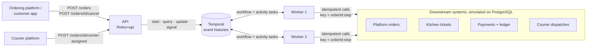
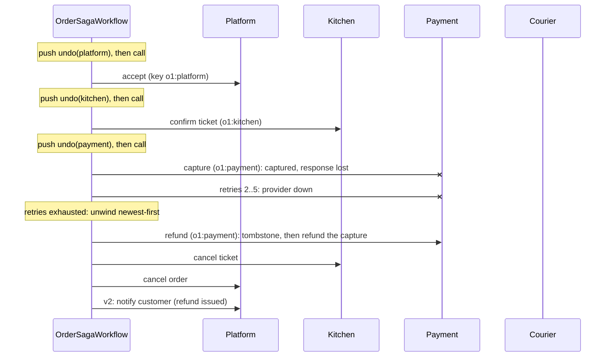

# order-saga-temporal

[](https://github.com/hekimcan206/order-saga-temporal/actions/workflows/ci.yml)
[](https://github.com/hekimcan206/order-saga-temporal/actions/workflows/codeql.yml)


[](LICENSE)

A delivery-order saga on Temporal's .NET SDK: the ordering platform accepts the order, the kitchen confirms a ticket,
the payment is captured, a courier is dispatched. If anything fails, or the customer cancels in time, the steps that
ran are compensated **in reverse order**. The point of the repository is the part textbook sagas skip: a step can take
effect without the orchestrator ever seeing success. This saga still undoes it, and a seeded fault campaign shows
what each defence is worth.

> All data is synthetic: orders, stores, couriers and customer references are generated. There is no real personal,
> payment or business data, and the downstream systems are simulators.

## Problem

Four systems, no shared transaction. "If the payment fails, cancel the ticket" is the easy part. These are the hard ones:

1. **Unknown outcomes.** The provider captured the money and the answer was lost. If the provider then stays down until
   retries run out, the workflow has only seen failures, for a charge that exists.
2. **Retries.** Each retry without a stable key is a new charge.
3. **Zombies.** An attempt that hung past its timeout reaches the provider *after* the saga refunded. Now the refund
   happened before the charge it was meant to undo.
4. **Crashes and time.** Workers die mid-saga. A courier is assigned minutes later, or never. The customer cancels.
   Compensations fail too.
5. **Deploys.** Sagas are still running when new workflow code ships. A change that alters their command sequence
   strands them.

## Solution

| Concern | How |
|---|---|
| Orchestration | One Temporal workflow per order (`order-{orderId}`). Sequential C#; the event history is the saga log, the stage is a workflow query ([ADR 0001](docs/adr/0001-orchestrated-saga-on-temporal.md)) |
| Unknown outcomes | **Compensation registered before the step is scheduled**, stable idempotency key per order and step, undo that writes a **tombstone** first so a late forward call refuses itself ([ADR 0002](docs/adr/0002-compensate-on-unknown-idempotency-keys-and-tombstones.md)) |
| Reverse order | A deterministic compensation log unwinds newest-first and keeps going past a failed undo; FsCheck-tested |
| Retries | Forward steps: 5 attempts, then unwind. Compensations: unlimited, on a token detached from workflow cancellation. Business rejections are non-retryable ([ADR 0003](docs/adr/0003-retries-timeouts-and-human-interaction.md)) |
| People | Courier assignment is a signal awaited on a durable timer; customer cancellation is a validated **workflow update** (accepted or rejected, with a reason); operator cancel still unwinds |
| Deploys | v2 change behind `Workflow.Patched`; **golden event histories** of every saga path replayed in the unit suite, no server ([ADR 0004](docs/adr/0004-workflow-versioning-with-patches-and-golden-histories.md)) |
| Truth | Downstream systems simulated on PostgreSQL with an append-only ledger; tests judge outcomes from those tables, not from the workflow ([ADR 0005](docs/adr/0005-dev-server-and-simulated-downstream.md)) |

## Architecture





## Why this design

- **Orchestration over choreography.** "Which steps ran for order X and what is left to undo" has one answer: the
  workflow history. Compensation order is code, not an emergent property of four event handlers.
- **Compensate on unknown, not on success.** Measured: registering compensations after success leaked money in every
  lost-response-then-outage and every zombie case (40 of 140 sagas inconsistent), while each workflow reported a clean
  unwind. The production saga: 0 of 140.
- **Unlimited compensation retries.** A refund the saga gives up on is money silently kept. A saga that keeps trying
  stays visible and alertable.
- **Updates for cancellation.** The customer gets an answer. A rejected update leaves no trace in the history.
- **Golden histories in the unit suite.** Determinism mistakes are found in seconds by replaying real histories, not in
  production by stuck sagas.

## Quick start

```bash
docker compose up
```

Starts PostgreSQL, the Temporal CLI dev server (UI on http://127.0.0.1:58233), the migrator, the API
(http://127.0.0.1:58280, OpenAPI at `/scalar`), two worker replicas, and a demo that runs eight scenarios through the
API and checks the downstream tables. It exits 0 only if every saga ended as expected with no broken rule:

```text
{"scenario":"happy-path","ok":true,"status":"Completed","compensations":[],"downstream":{"platform":"Active","kitchen":"Active","courier":"Active","charges":1,"netChargedKurus":49000},"violations":[],"ms":899}
{"scenario":"card-declined","ok":true,"status":"Compensated","failedStep":"Payment","compensations":["Payment","KitchenTicket","PlatformAccept"],"downstream":{"platform":"Undone","kitchen":"Undone","courier":"None","charges":0,"netChargedKurus":0},"violations":[],"ms":312}
{"scenario":"payment-captured-response-lost-then-outage","ok":true,"status":"Compensated","failedStep":"Payment","reason":"Unavailable: payment is unavailable","compensations":["Payment","KitchenTicket","PlatformAccept"],"downstream":{"platform":"Undone","kitchen":"Undone","courier":"None","charges":1,"netChargedKurus":0},"violations":[],"ms":4813}
{"scenario":"customer-cancels-while-waiting","ok":true,"status":"Compensated","reason":"cancelled by the customer","compensations":["CourierDispatch","Payment","KitchenTicket","PlatformAccept"],"downstream":{"platform":"Undone","kitchen":"Undone","courier":"Undone","charges":1,"netChargedKurus":0},"violations":[],"ms":328}
...
{"summary":true,"scenarios":8,"passed":8,"violations":0,"failures":[]}
```

(Lines shortened; `expected` and `orderId` fields omitted.) Try the API yourself:

```bash
curl -s -H "X-Api-Key: api-dev-only" -H "Content-Type: application/json" http://127.0.0.1:58280/api/v1/orders -d '{
  "order": {"orderId": "o-1", "storeId": "store-01", "customerRef": "c-1",
            "lines": [{"sku": "doner", "name": "Döner", "quantity": 1, "unitPriceKurus": 25000}]},
  "faults": [{"step": "Payment", "phase": "Forward", "kind": "Reject"}]}'
curl -s -H "X-Api-Key: api-dev-only" http://127.0.0.1:58280/api/v1/orders/o-1
curl -s -H "X-Api-Key: api-dev-only" http://127.0.0.1:58280/api/v1/orders/o-1/downstream
```

Prices are in kuruş (1/100 Turkish lira) so money never touches floating point.

Local development: `docker compose up postgres temporal migrator`, then `dotnet run --project src/OrderSaga.App`
(the Development settings point at the compose ports). Tests: `dotnet test` (Docker must be running).

## Results

All measured on a loaded laptop (i7-13620H, Docker Desktop on Windows 11), Temporal dev server and PostgreSQL each capped
at 2 CPUs, harness in a Linux container. Method, raw data and caveats: [docs/benchmarks.md](docs/benchmarks.md).

| Measurement | Result |
|---|---|
| Fault campaign, 140 seeded plans per variant: inconsistent outcomes | **Correct 0** · compensate-after-success 40 · no idempotency key 25 · no tombstone 20 |
| Happy-path saga, sequential | p50 **249.9 ms** (same 4 calls without durability: 14.6 ms); ~200 ms of it is a ~40 ms server-side wait per workflow task on this dev server |
| Throughput, one worker | 4.2 sagas/s at 1 client, plateau ~29-32 sagas/s from 16 clients (server CPU-bound) |
| Full 4-step reverse unwind after a rejection | p50 497.7 ms |
| Payment captured, answer lost, provider down: unwound | p50 4.7 s (3 s of it is the retry policy) |
| Worker process killed mid-payment: kill to saga completed | p50 **15.8 s** with SDK defaults → **6.9 s** with sticky-queue timeout 1 s; exactly one charge in every run |
| Golden history replay (determinism check, no server) | p50 4.1 ms (29 events) / 8.8 ms (68 events) |

Tests: 60 unit, property and golden-replay tests; 55 Testcontainers integration tests on Temporal and PostgreSQL 17
(saga paths, defence-off variants, a 40-plan random fault campaign, API, hard process kills, history recording).

## Repository layout

```
src/OrderSaga.Core         steps, compensation log, consistency invariant, fault model (no Temporal dependency)
src/OrderSaga.Downstream   PostgreSQL simulators: idempotency keys, tombstones, ledger, fault injection, migrations
src/OrderSaga.Workflows    OrderSagaWorkflow, the shared saga engine, activities, lab workflow
src/OrderSaga.App          one image: --migrate-only | Roles=api | Roles=worker | --demo
tests/                     unit + property + golden replay (Histories/v1, v2); Testcontainers integration
benchmarks/                harness: latency, throughput, compensation, campaign, replay, recovery
docs/                      ADRs, threat model, benchmarks
```

## Limitations and next steps

- **Dev server, not a cluster.** Tests, demo and benchmarks use the single-process Temporal dev server with in-memory
  persistence. The ~40 ms workflow-task dispatch wait and the ~30 sagas/s plateau are properties of that setup on this
  machine; a production cluster was not measured.
- **Simulated downstream systems.** They are faithful about idempotency and failure modes, not about latency or the
  quirks of real payment and courier APIs. Real providers must support keys that outlive the retry window and
  void-by-key before the original call is seen; where they do not, a reconciliation sweep is needed (not built).
- **The consistency checker judges money and effect state, not row counts.** In the no-idempotency-key variant the
  duplicated tickets and dispatches are not counted as violations, so that variant's real damage is understated.
- **Authentication is a shared API key**, webhooks are unsigned, and there is no rate limiting. See the
  [threat model](docs/threat-model.md) for the production versions.
- **No payload encryption.** Inputs carry only opaque references; if personal data were ever added, a Temporal payload
  codec would be required.
- **Patch lifecycle.** The v2 patch is not deprecated yet; v1 golden histories stay until it is.
- Next: worker versioning for larger rewrites, signed courier webhooks, an alert on saga age for refunds that keep
  failing, and a measurement against a real multi-service Temporal deployment.

## Privacy note (KVKK)

KVKK is Turkey's personal data protection law (comparable to the GDPR). This project processes no personal data: the
customer is an opaque reference validated to a short id, workflow inputs and histories contain no names, addresses or
card data, and committed golden histories are stripped of machine identities. All data is synthetic.

## License

[MIT](LICENSE)
